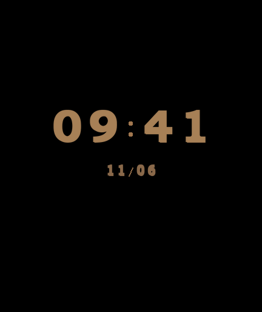

# 爱上火车 · REDMI Watch 5 动态表盘

**v1.0.8 · 3.93 MB · 432 × 514**。2026 年 11 月 8 日，用户确认红米手表 5 实机测试通过。表盘移植与打包由 Codex 完成。

## 安装和使用

1. 下载 Release 中的表盘安装包。
2. 用表盘自定义工具将安装包发送到手表。工具提示发送完成后，请等手表完成安装并刷新表盘列表。 [表盘自定义工具](https://www.bandbbs.cn/)
3. 选中《爱上火车》表盘。**轻点表盘上的「爱上火车」Logo，即可进入手表的系统音乐界面。** 长按表盘可在系统编辑中切换动态和静态。

[下载表盘安装包](https://github.com/xuanyide01/maitetsu-rw5/releases/download/watchface-v1.0.8/maitetsu-rw5-watchface-v1.0.8.bin)

## 画面预览

动态表盘取原作开场镜头拉远和旋转的尾段，约 1.2 秒，进入后播放一次。之后以 20 帧/秒播放雪层、光效和角色眨眼。息屏为黑底时间和日期。

| 动态 GIF | 主表盘 PNG | 息屏 PNG |
| --- | --- | --- |
|  |  |  |

原作由 Lose 开发，HIKARI FIELD 发行。原作 CG、角色和 Logo 归各权利人所有。感谢「表盘自定义工具」团队提供的安装工具。 [原作官网](https://hikarifield.co.jp/maitetsu_lastrun/) · [表盘自定义工具](https://www.bandbbs.cn/)
